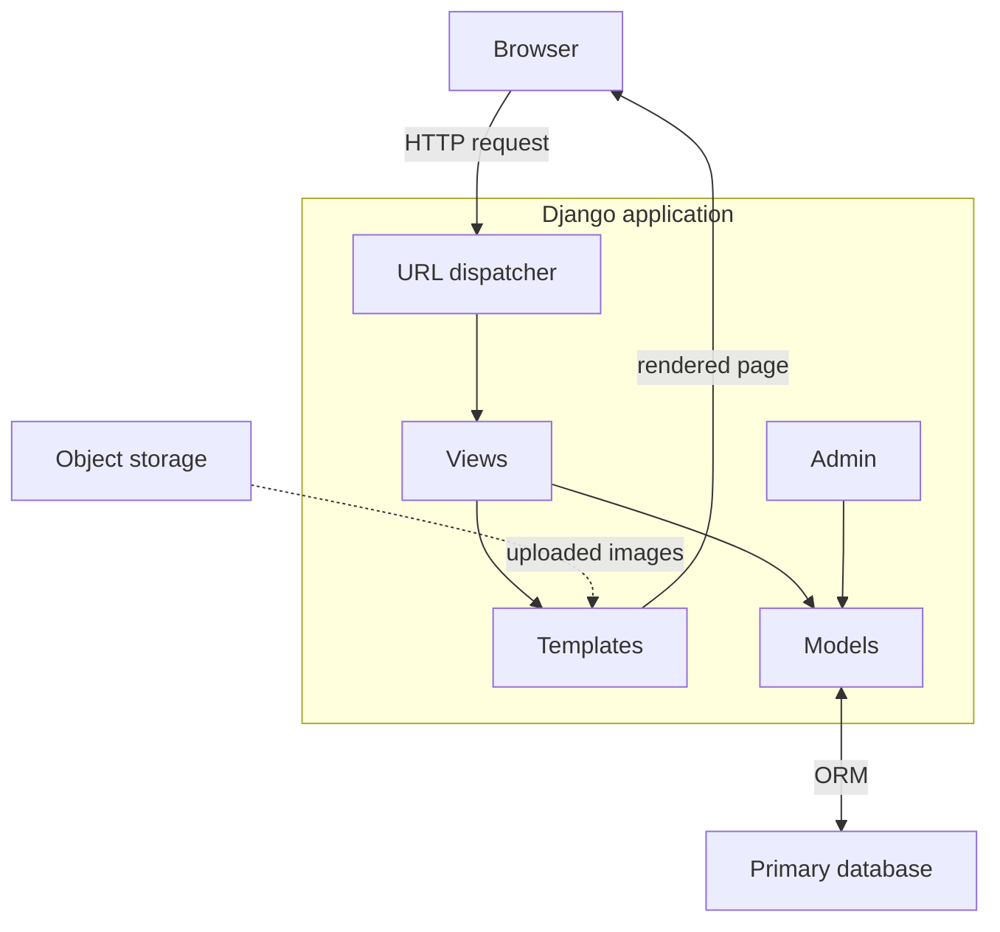
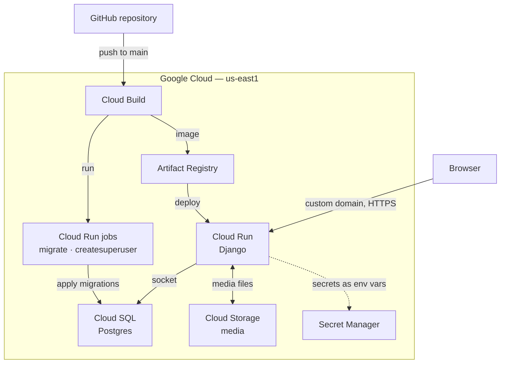

# Architecture and infrastructure

Two products, one Django project, deployed as one service. This document covers what the
application is built from, where it runs, and the path a copilot question takes beyond it.

## Application

Ordinary Django: models define the data, class-based views select and shape it, templates
present it. The repository holds two apps — `content` for the site and `demo` for the
copilot — which share the platform below them and nothing else.

The database is Postgres in production and SQLite in development, behind the same ORM.
Nothing in the application knows which one it is talking to.

## Deployment

Google Cloud, in `us-east1`. The service scales to zero when idle, and the database is
managed rather than run by the application.

