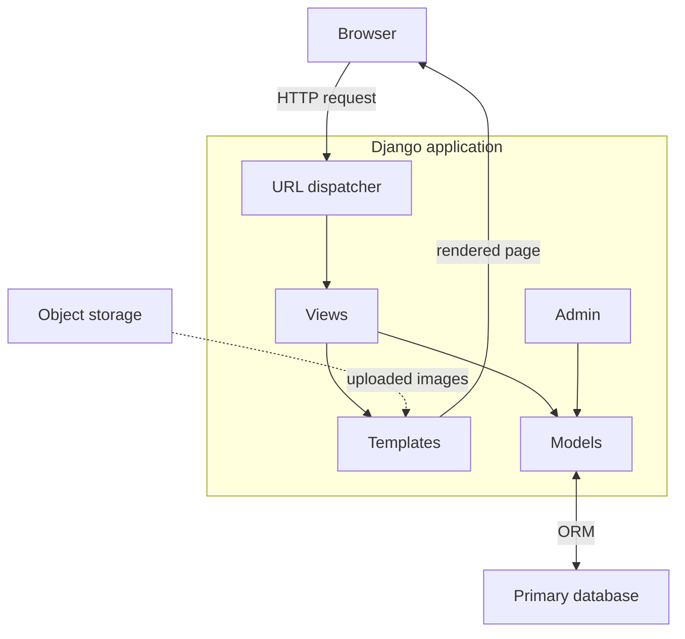
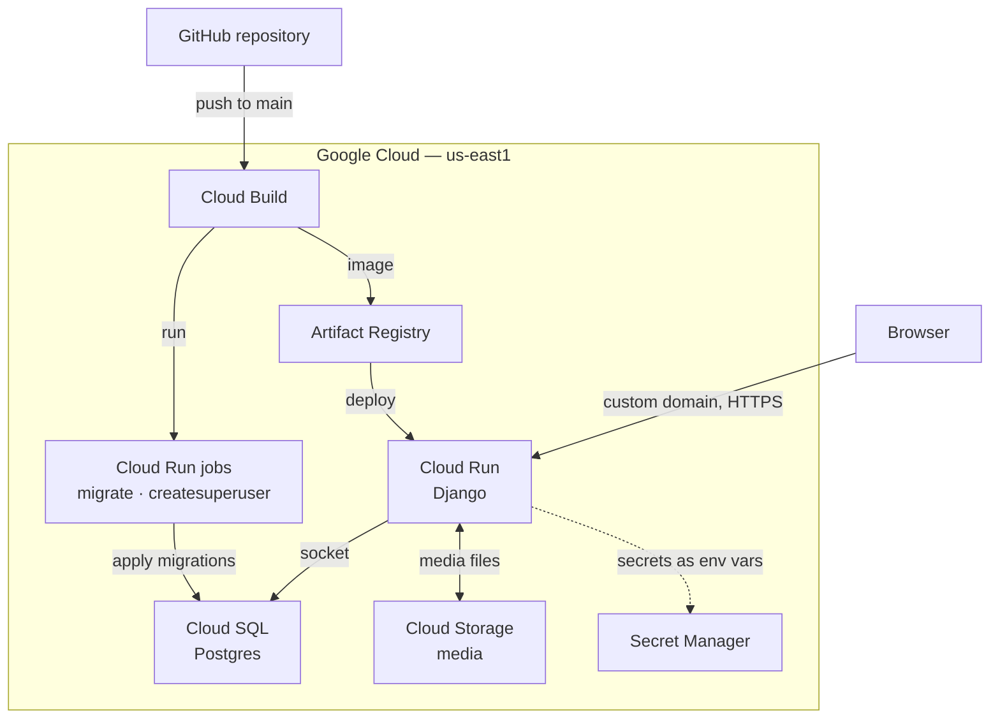
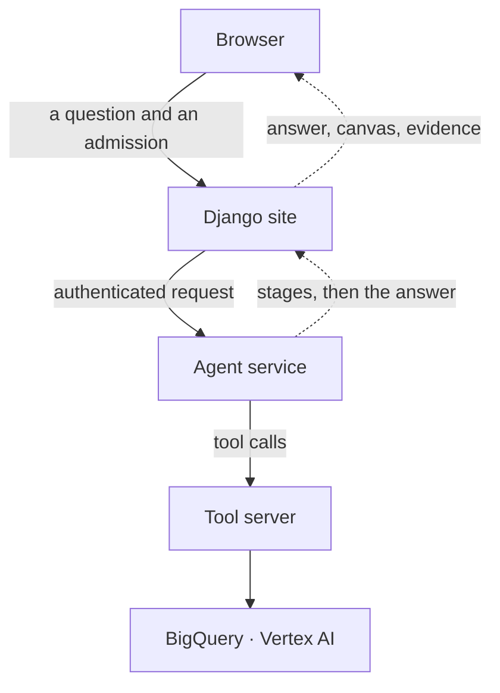

# Architecture and infrastructure

Two products, one Django project, deployed as one service. This document covers what the
application is built from, where it runs, and the path a copilot question takes beyond it.

## Application

Ordinary Django: models define the data, class-based views select and shape it, templates
present it. The repository holds two apps — `content` for the site and `demo` for the
copilot — which share the platform below them and nothing else.

The database is Postgres in production and SQLite in development, behind the same ORM.
Nothing in the application knows which one it is talking to.

## Deployment

Google Cloud, in `us-east1`. The service scales to zero when idle, and the database is
managed rather than run by the application.

## The copilot's path, beyond this application

The site holds none of the clinical reasoning. A question leaves it, and the answer comes back
with the canvas and the evidence the agent composed.

Both services are private and called with an identity token. The site is the only caller of the
agent, and the agent is the only caller of the tool server, so neither can be reached from the
public internet.

## Security posture

- **Transport and framing.** Content-security policy applied by middleware, with exactly one
  path exempted for the rich-text editor; clickjacking protection; secure session cookies in
  production, and sessions that expire when the browser closes.
- **Failed authentication.** Five failed attempts on a username locks that account for an
  hour. A successful sign-in resets the count. Lockout is keyed on the username by design, not
  on the address.
- **Secrets.** Held in Secret Manager and injected as environment variables. They are never in
  the image and never in the repository.
- **Service identity.** The internal services require authentication and are reached with an
  identity token, so IAM is the first boundary rather than the application.
- **Authorization.** For the copilot, the admission cohort is the boundary: a question about a
  patient outside it is refused before any spend and before any call is made.

## Delivery

A push to `main` builds an image in Cloud Build, publishes it to Artifact Registry, and deploys
it to Cloud Run. Schema migrations and the initial superuser run as Cloud Run jobs rather than
on request. The deployed revision is reported by the health route, so a release can be
confirmed rather than assumed.

## Observability

- **Traces.** Langfuse, running as its own stack, records each agent run: the tools called, the
  evidence shown to the model, and how long each step took.
- **Correlation.** Cloud Trace ids pair the site's log lines with the service's for the same
  user action.
- **Provenance.** Each stored answer carries the trace id of the run that produced it and the
  code revision that served it, so an answer can be explained after the code has moved on.

See [`../GCP_DEPLOYMENT_GUIDE.md`](../GCP_DEPLOYMENT_GUIDE.md) for the step-by-step deployment
walkthrough, and [`../../infra/`](../../infra/) for the supporting stacks.
