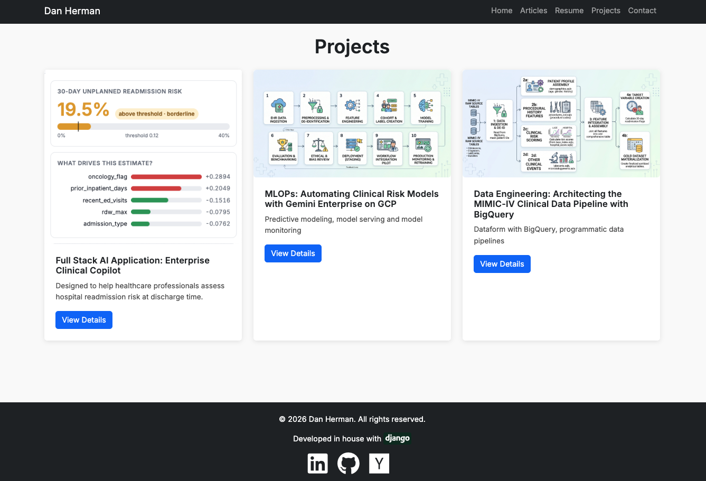

# Content management system — the personal site

Custom CMS written in Django, designed to create content indie web style using POSSE (Publish on your Own Site, Syndicate Elsewhere) philosophy

## Capabilities

| Capability | What it does |
|---|---|
| Articles | Long-form writing, organised into the site's sections and reachable at a stable address. |
| Categories | The main menu — tech, music, enlightenment, resume, projects, contact — ordered by hand and hideable without being deleted. |
| Projects | Portfolio entries with a description, links to a live demo and its source, and the technologies used. |
| Contact | A public form whose messages land in an admin inbox rather than an email account. |
| Authoring | Rich text in CKEditor 5, with images uploaded to media storage rather than served from the container. |
| Administration | Django admin for every model above. |
| Presentation | Responsive templates sharing one base layout, with static assets served by the application. |
