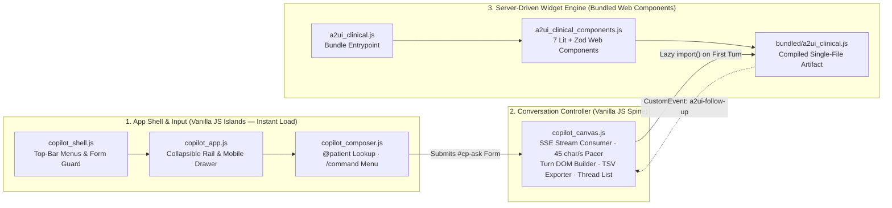

# Frontend JavaScript Architecture & Code Comprehension Guide (`static/js/`)

## 1. How to Think About JavaScript Architecture (The Python Translation)

In Python, application code runs in a single controlled environment (the server container), and `import foo` reads a module from the local disk in microseconds. 

In Frontend JavaScript, architecture spans **two fundamentally different environments**:
1. **Build Time (Node.js / `npm` / Vite):** Equivalent to a Python virtual environment (`pip`) combined with a static compiler.
2. **Run Time (The User's Browser):** Every `import` statement in an unbundled browser script triggers a separate **HTTP network request over the internet**.

### Why `npm` and the Toolchain (`Vite` / `Rollup`) Exist
In `demo_a2ui.js`, an engineering comment records the exact bottleneck that forced the introduction of `npm` and a bundler:
> *"Imported at the top it sits in front of the patient rail's paging code, which is what made the console page wait on 385 module requests before it could paginate."*

* **Before `npm` + Vite:** When the browser loaded `@a2ui/lit`, `lit`, `zod`, `markdown-it`, and `dompurify` directly as unbundled ES modules, opening the page triggered **385 separate waterfall HTTP requests**. That network storm delayed initial page interactivity and tripped Cloud Armor's 60 req/min rate limit.
* **`npm` (`package.json`):** The exact equivalent of `pip` (`requirements.txt`). It downloads third-party JavaScript packages (`lit`, `zod`, `dompurify`, `@a2ui/lit`, `@preact/signals-core`) into a local `node_modules/` directory.
* **The Bundler (`Vite` / `Rolldown`):** Walks the `import` dependency graph at build time, tree-shakes unused code, and packs those 385 modules into **one single file** (`bundled/a2ui_clinical.js`).
* **Lazy Loading (`import(rendererUrl)`):** The initial Django page load serves only tiny, zero-dependency Vanilla JS scripts (`copilot_shell.js`, `copilot_app.js`, `copilot_composer.js`, `copilot_canvas.js`) so First Contentful Paint occurs in **< 50 milliseconds**. Only when an agent turn needs to render a rich clinical widget does `copilot_canvas.js` execute `import(rendererUrl)` to fetch `bundled/a2ui_clinical.js` on demand.

---

## 2. System Topology & File Inventory

The `static/js/` directory contains **10 source files** and **3 compiled bundles**, which divide into **two distinct generations**:
1. **Active Modern Architecture (Phase 2–5):** 6 source files + 1 compiled bundle implementing a **Server-Driven UI (A2UI) with Progressive Vanilla Islands**.
2. **Legacy Split-Pane Architecture (Phase 1):** 4 source files + 2 compiled bundles retained from the initial prototype.

### 2.1 Active Modern Architecture (6 Source Files + 1 Bundle)

| File | Python Equivalent | Architectural Role & Purpose |
|---|---|---|
| **`copilot_shell.js`** (66 lines) | Base template helper | **Top-Bar Menu Controller:** Manages opening and closing the top-left application menu and top-right account menu (`aria-expanded`, click-outside dismissal, `Escape` key handling), and guards un-wired forms from triggering accidental `GET` reloads. Written as an Immediately Invoked Function Expression (IIFE) with zero dependencies. |
| **`copilot_app.js`** (135 lines) | Layout / Viewport controller | **Collapsible Shelf & Responsive Drawer:** Governs the left navigation sidebar across the `700px` media breakpoint. Above `700px`, it collapses the sidebar into a 64px icon rail and persists the user's preference in `localStorage`. Below `700px`, it converts the sidebar into a temporary slide-over overlay drawer with a backdrop scrim. |
| **`copilot_composer.js`** (357 lines) | Form & Input controller | **The `@patient` & `/command` Omnibox:** Controls the prompt bar. Typing `@` triggers a debounced (`300ms`), `AbortController`-backed `fetch()` lookup against the patient table and pins the chosen patient into a visual pill and hidden `hadm_id` input. Typing `/` opens the local slash-command autocomplete menu (`/ehr`, `/meds`, `/labs`, `/pubmed`). Also manages `<textarea>` auto-sizing up to a `200px` ceiling. |
| **`copilot_canvas.js`** (1,040 lines) | `http.py` + `turn.py` (Frontend Spine) | **Main Workspace & Stream Orchestrator:** Owns the conversation feed and sidebar thread list: 1. Dispatches `POST` requests to `/ask/stream` with `Accept: text/event-stream`. 2. Parses SSE frames (`stage`, `answer_delta`, `prose_settled`, `answer`, `error`). 3. **Reading-Cadence Pacer:** Releases streamed tokens to the DOM at `45 chars/sec` (with `3x` catch-up above 350 queued chars) while holding unclosed `^[1` citation tags so raw syntax never flashes on screen. 4. Lazily imports `bundled/a2ui_clinical.js` to mount A2UI surfaces. 5. Manages the sidebar thread list (pin, delete, `sessionStorage` tab resumption) and `.tsv` table exports. |
| **`a2ui_clinical_components.js`** (742 lines) | Pydantic + Component Library | **Phase 2–5 Clinical Web Components:** Uses **Zod** (the JavaScript equivalent of Python's `Pydantic`) to validate JSON props emitted by `services/agent/a2ui.py`, and **Lit** (Google's Web Components framework) to render 7 Shadow-DOM-isolated clinical widgets: • `RiskInfluencers` (`<a2ui-risk-influencers>`): Clickable SHAP driver bars. • `CitedNarrative` (`<a2ui-cited-narrative>`) & `CitationPopoverElement`: Prose renderer that converts `^[n]` and `^[PMID: n]` markers into interactive pills and accessible focus-trapped popovers. • `LiteratureList` (`<a2ui-literature-list>`): PubMed bibliography cards. • `ComparativeRiskMatrix` (`<a2ui-comparative-risk-matrix>`): Patient baseline vs. published cohort table. • `LabTrendCard` (`<a2ui-lab-trend>`): Table with inline SVG sparklines and shaded reference bands. • `MedicationGrid` (`<a2ui-medication-grid>`): Verified discharge medication table. • `SourceCard` (`<a2ui-source-card>`): Note passage card. |
| **`a2ui_clinical.js`** (29 lines) | `__init__.py` | **Bundler Entrypoint:** A pure export barrel that exposes `MessageProcessor`, `basicCatalog`, `ContextProvider`, `renderMarkdown`, and `buildClinicalCatalog` so Vite compiles them into `bundled/a2ui_clinical.js`. |

### 2.2 Legacy Phase 1 Files (4 Source Files + 2 Bundles)

| File | Status | Purpose |
|---|---|---|
| **`demo_flow.js`** (625 lines) | **Legacy (Phase 1)** | Original split-pane controller (`Screen 1` patient rail, `Screen 2` collapsible chapters, `Screen 3` trace toggle) used before the modern `copilot_*` shelf layout. |
| **`demo_a2ui.js`** (228 lines) | **Legacy (Phase 1)** | Original canvas adapter connecting `demo_flow.js` to Phase 1 widgets (compiled into `bundled/demo_a2ui.js`). |
| **`a2ui_risk_components.js`** (320 lines) | **Legacy (Phase 1)** | First-generation Q3 spike widgets (`RiskBar`, `FactorBars`, `TraceCard`) superseded by `a2ui_clinical_components.js`. |
| **`a2ui_renderer.js`** (21 lines) | **Legacy (Phase 1)** | Bundler entrypoint for `a2ui_risk_components.js` (compiled into `bundled/a2ui_renderer.js`). |

---

## 3. Core Frontend Engineering Concepts

| Term | Definition |
|---|---|
| **IIFE (Immediately Invoked Function Expression)** | A JavaScript module pattern `(function() { 'use strict'; ... })()` that executes immediately and creates a private variable scope, preventing functions and state from leaking onto the global `window` object without requiring a build step. |
| **Web Components & Shadow DOM (`LitElement`)** | A browser-native component standard where custom HTML tags (such as `<a2ui-lab-trend>`) encapsulate their internal DOM tree and CSS styles inside a **Shadow Root**, preventing page-level stylesheets and widget stylesheets from colliding. |
| **Server-Driven UI (`A2UI v0.9`)** | An architectural pattern where the backend (`services/agent/a2ui.py`) composes a declarative JSON layout specification (`createSurface` + `updateComponents`), and the frontend (`MessageProcessor`) dynamically instantiates the corresponding UI widgets. |
| **Runtime Schema Validation (`Zod`)** | The TypeScript/JavaScript equivalent of Python's `Pydantic`. Every A2UI component declares a `z.object({...}).strict()` schema that validates the backend's JSON props before rendering. |
| **DOM-Mediated Event Bus (`CustomEvent`)** | Decoupled inter-module communication where independent scripts communicate by reading/writing HTML attributes (`data-command`, hidden `<input>` fields) and dispatching browser events (`cp:command-consumed`, `a2ui-follow-up` with `bubbles: true, composed: true` to cross Shadow DOM boundaries). |
| **Dynamic Import (`import()`)** | An asynchronous JavaScript primitive that fetches and evaluates a compiled ES module bundle only when needed at runtime, keeping the initial page payload minimal. |

---

## 4. Architectural Evaluation: Strengths vs. Drift

### 4.1 What Was Architected Well
1. **Islands Architecture (Zero-Framework Shell + Lazy Web Components):**
   By keeping the outer application shell (`copilot_shell.js`, `copilot_app.js`, `copilot_composer.js`, `copilot_canvas.js`) in dependency-free Vanilla JS and reserving the compiled framework bundle (`Lit` + `Zod` + `A2UI`) strictly for clinical canvas widgets loaded via `import()`, the page achieves instant startup without sacrificing rich interactive visualizations.
2. **Strict Separation of Rendering from Interpretation:**
   The frontend does not infer clinical sections or heal citation numbers. It renders the server's pre-resolved `citations` and `references` arrays and swaps text cleanly when a `prose_settled` SSE frame signals that a backend guardrail modified the streamed draft.
3. **Defense-in-Depth XSS Sanitization:**
   All Markdown rendering inside `bundled/a2ui_clinical.js` passes through **DOMPurify** before injection, and `copilot_canvas.js` builds DOM nodes via `document.createElement` and `textContent` rather than unsafe `innerHTML` concatenation.
4. **Clinical Reading Ergonomics:**
   The `45 chars/sec` token pacer in `copilot_canvas.js` includes a regex lookahead hold (`OPEN_MARKER = /\^(\[[^\]]*)?$/`) that buffers incomplete citation markers (`^[1`) until the closing bracket arrives, preventing raw syntax flicker while the clinician reads.

### 4.2 Where the Frontend Architecture Drifted
1. **`copilot_canvas.js` Has Become a 1,040-Line "God Controller" (Mirroring `http.py`):**
   `copilot_canvas.js` currently combines five distinct responsibilities in a single closure:
   * SSE stream framing and consumption (`consume`)
   * Character-level reading cadence pacing (`drain`, `drawn`, `appendProse`)
   * Turn DOM construction (`createTurn`, `fillTurn`, `presentReferences`, `presentFollowUps`)
   * Sidebar thread history management and viewport-fixed context menus (`loadThreads`, `renderThreads`, `openRowMenu`, `confirmDelete`)
   * TSV spreadsheet serialization (`structuredRows`)
2. **Component Schema Coupling Inside `structuredRows()` (`copilot_canvas.js` lines 282–356):**
   To support the "Export this table" (`.tsv`) button, `copilot_canvas.js` reaches directly into the raw A2UI JSON envelope and hardcodes `if/else` branches for `RiskInfluencers`, `MedicationGrid`, `LiteratureList`, `LabTrendCard`, and `ComparativeRiskMatrix`—even duplicating the `percent()` formatter from `a2ui_clinical_components.js`. Exporting tabular data from an A2UI surface belongs inside the `a2ui_clinical_components.js` catalog alongside the component schemas themselves.
3. **Shadow-DOM Piercing (`inlineMarker` in `copilot_canvas.js` lines 605–618):**
   When a user expands a reference in the bottom drawer, `copilot_canvas.js` recursively walks `.shadowRoot` trees across the turn to locate `button.cite[data-cite]` inside `<a2ui-cited-narrative>` and mutates its inline `style.outline`. Reaching into a Web Component's private Shadow DOM violates encapsulation; instead, `copilot_canvas.js` should dispatch a standard event or call a public method on `<a2ui-cited-narrative>`.
4. **Co-Located Legacy Phase 1 Files:**
   The four Phase 1 files (`demo_flow.js`, `demo_a2ui.js`, `a2ui_risk_components.js`, `a2ui_renderer.js`) and their two compiled bundles (`bundled/demo_a2ui.js`, `bundled/a2ui_renderer.js`) sit in the same directory as the active `copilot_*` and `a2ui_clinical*` modules, creating duplicate component definitions (`SourceCard`, `LiteratureList`).

---

## 5. Toolchain Options Comparison

| Option | Architecture | Fit for Enterprise Clinical Copilot |
|---|---|---|
| **1. Current Architecture: Vanilla JS Islands + Vite-Bundled `@a2ui/lit`** | Django templates + zero-build Vanilla JS shell (`copilot_*.js`) + Vite-bundled Lit/Zod Web Components (`bundled/a2ui_clinical.js`) loaded on demand. | **Optimal Fit (Keep).** Google's `@a2ui/lit` (`v0.9`) requires `lit`, `zod`, `@preact/signals-core`, `markdown-it`, and `dompurify`, making an `npm` + Vite bundler mandatory for the widget layer, while Vanilla JS keeps the Django shell fast and simple. |
| **2. HTMX + Alpine.js (No Build Step)** | Server returns pre-rendered HTML partials on every interaction; no `npm` or bundler. | **Poor Fit for A2UI & Token Pacing.** Cannot natively consume declarative A2UI v0.9 JSON envelopes or perform 40ms client-side character pacing with lookahead citation buffering. |
| **3. Full React / Next.js Single-Page App (SPA)** | Separate Node.js/TypeScript frontend repository consuming Django strictly as a REST API. | **Unnecessary Complexity.** Duplicates routing, session state, and CSRF security that Django's built-in middleware already provides cleanly in Layer 1. |