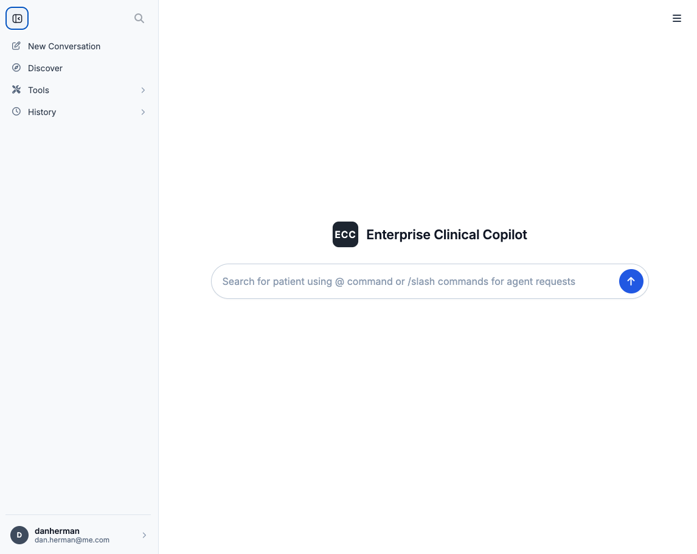

# Enterprise Clinical Copilot — the front door

Presentation layer for full stack AI Application.  Designed to help health care professionals assess unplanned readmission risk for patients admitted for more than 24 hrs.

## Capabilities

| Capability | What it does |
|---|---|
| Entry | A public front door that introduces the copilot and carries the clinician into the console. |
| Authentication | Uses Django middleware authentication in addition to `django-allauth` for social oAuth integration  |
| Content security | Uses Django security middleware to insepct encrypted traffic and insert security headers/cookies into requests |
| Failed-login lockout | Uses Django axes middleware for failed security lockout policy |
| Session management | Stores session state as conversations used in memory retention policy integrated with agent orchestrator |
| Conversation | Uses Django middleware state management with memory retention policy to store and retrieve conversations with agents|
| Patient selection | `@` in the composer searches the admission cohort and pins one patient to the turn. |
| Slash Commands | `/risk`, `/meds`, `/ehr` and `/pubmed` in the composer as convenient UX shortcuts |
| Composer | Primary input for conversation integration with AI agents |
| Streaming | Receives real time streaming responses from agents with deterministic guardrails in parallel shaping responses |
| Canvas | Renders composible UI components direct from agent payloads using A2UI/Lit framework |
| Credits | Users receive fixed number of request credits to keep AI platform use within budget constraints |

